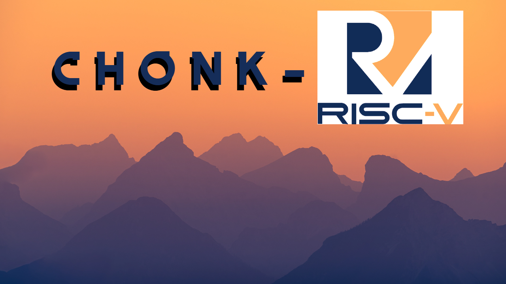
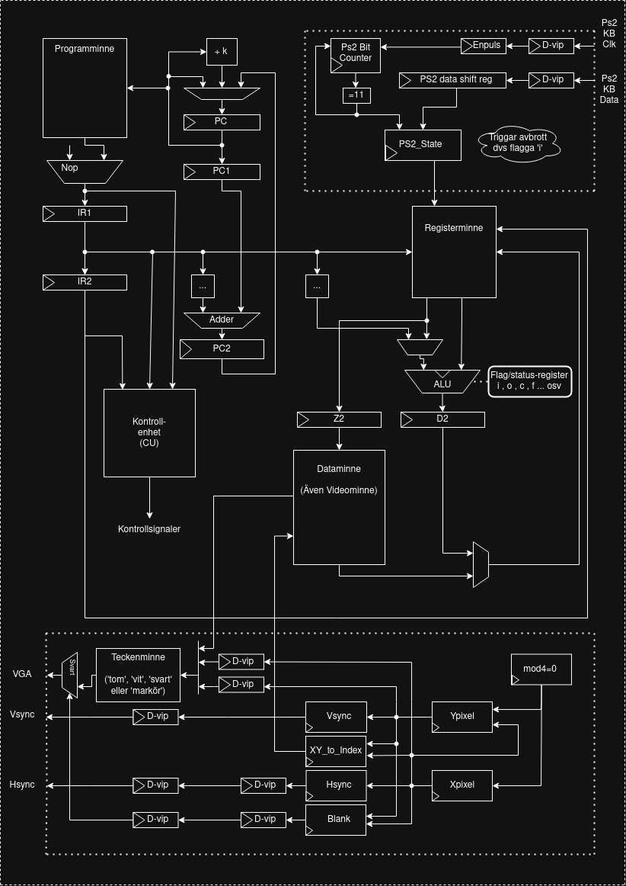

# CHONK-RISC-V

 

### Sammanfattning

Projektet är en processorkärna (för FPGA syntetisering) som implementerar en RISC-V instruktionsuppsättning (***RV32I*** Maj 2010 UC Berkeley). Målet är kompabilitet med specifikationen och verifierabarhet genom tester.

Projektet bygger vidare på ett grupparbete från kursen en kurs i datorkonstruktion där vi designade en processor som var anpassad för att spela Othello. Den processorn bestod av en 2-stegs pipeline och var uppdelat i program och dataminne, dvs hade en Harvard-arkitektur. Den hade ingen "Data-Forwarding" vilket innebar att många NOP:s behövde petas in manuellt efter vissa instruktioner i assembly-programmet som skulle exekveras på processorn.

| Status        |               |
|---|---|
| Design        | Pågår         |
| Simulering    | Pågår         |
| Syntes        | Ej påbörjad   |
| FPGA-körning  | Ej påbörjad   |

Giltiga statusvärden är ej *påbörjad*, *pågår*, *klar*, samt *klar och testad*.

### Verifiering

Verifieringen att detta projekt uppfyller kriterierna för att räknas som RV32I-kompatibel kommer vara icke-formell/funktionell verifiering främst genom egna enhetstester genom testbänkar. Projektet ska även verifieras med officiella kompatibilitetstester i form av som riscv-arch-test. För att använda de testerna behöver man skriva ett plugin för att tala of hur kärnan startas och och minnessignaturer utläses. 
  
## Struktur för projektet

Projektet producerar tre delar:

- Dokumentationsdelen - (Kravspecifikation, Designspecifikation & Teknisk Dokumentation)
- Hårdvarudelen - (Datorkonstruktionen: Design och Testbänkar skrivna i VHDL)
- Mjukvarudelen - (Den uppkommna koden i det egna assembly-språket framtaget)

## Blockdiagram för hårdvara

...

 

# Utvecklings-Guide

## Set-up GHDL/ModelSim

Jag har valt att testa projektutveckling med open-source alternativ som [GHDL](https://github.com/ghdl/ghdl) för VHDL-simulering och VSCode tillägget Surfer för visualisering av simuleringarna. Alternativt går det också att simulera och visualisera signaler med ModelSim, och där fann jag det lättast att ta [ModelSim - Intel FPGA Starter Edition 2020.1](https://www.altera.com/downloads/simulation-tools/modelsim-fpgas-standard-edition-software-version-18-1). Om man har glömt eller inte vet hur man jobbar med ModelSim kan jag tipsa om att man kollar på [denna video](https://www.youtube.com/watch?v=9mpRF6bAY1g).

Ladda ner GHDL på [Windows](https://winstall.app/apps/ghdl.ghdl.ucrt64.mcode):
```
winget install -e --id ghdl.ghdl.ucrt64.mcode
```

Ladda ner GHDL på Ubuntu/Debian: 
```
sudo apt update
sudo apt install GHDL gtkwave
```

Ladda ner GHDL på Arch:
```
sudo pacman -S ghdl
```

Verfiera med
```
ghdl --version
```

Kom ihåg att lägga till extensions för VHDL syntax highlighting och Surfer i VSCode.

## Hur simulerar man med GHDL?

Man kan kan kompilera filer med hjälp av -a (för analyze) vilket MÅSTE göras i hierarkisk ordning (störst först). Man brukar kalla lägre hierarkiska entitys de som implementeras eller används i andra högre hierarkiska entitys. Så eftersom testbänkar implementerar det som ska testas gör att det testade (din "Unit Under Test")behöver kompileras först, därefter testbänken. Om jag använder/implementerar en mindre komponent inuti en större behöver de mindre kompileras först.

Typiskt Exempel:
```
# Analyze: Kompilera filer. Skapar en .cf-fil.
ghdl -a vhdl-fil.vhdl vhdl-tb.vhdl

# Elaborate: Länka komponenter för simulering, skapa objekt.
ghdl -e vhdl-entity-tb

# Run: Kör simulering med olika flaggor, vcd för format. Skapar en out.vcd-fil som kan öppnas med 
ghdl -r vhdl-entity-tb --stop-time=1us --vcd=out.vcd 
```

För att kolla på simuleringen så öppnar du out.vcd i VSCode, då öppnas surfer automatiskt.

Om simuleringar ska köras flera gånger kan en surfer state-file (.surf.ron) så man slipper välja vilka signaler som du vill titta på för din testbänk.

Ett annat tips kan vara att automatisera det med ett makefile likt Makefile_Exempel. Observera att exemplet behöver ändras för make clean beroende på om du är på windows eller linux.

## Kodskelett/Mallar

Det finns också ett kodskelett man kan använda om man vill slippa skriva lite kod. (Se kodskelett.vhd)